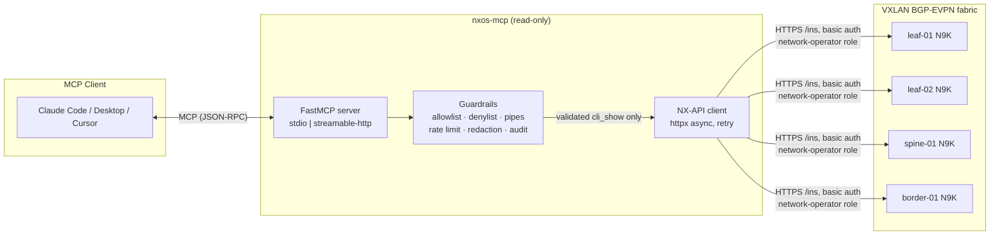

# nxos-mcp

A **read-only** [Model Context Protocol](https://modelcontextprotocol.io) server for
troubleshooting Cisco Nexus (NX-OS) switches over **NX-API (HTTP/HTTPS)**, designed
for **VXLAN BGP-EVPN fabrics with many VRFs**.

It lets an LLM client (Claude Code, Claude Desktop, Cursor, …) safely:

1. Run **validated `show` commands** on one or many devices (bounded fan-out).
2. Troubleshoot **VXLAN/EVPN**, **vPC**, **underlay** (OSPF/IS-IS/BGP/BFD), and
   **per-VRF reachability** (routing, ARP, BGP, ping, traceroute).
3. Follow guided **troubleshooting skills** (runbooks) that chain tools in the right order.

The server **never** changes device configuration. Commands are validated in code
against a strict allowlist before any network I/O; anything that could mutate state
(`configure`, `reload`, `write`, `clear`, …) is rejected and audit-logged.

## Architecture



Every command flows: **tool → validator (fail-closed) → rate limiter → NX-API
(`cli_show` only) → redaction → size cap → tool result**. The audit log records
every attempt (allowed or blocked) as JSON lines; credentials never appear in
tool arguments, logs, or outputs.

## Quick start

```bash
uv sync
cp config/inventory.example.yaml config/inventory.yaml   # edit for your fabric
cp .env.example .env                                     # set credentials

uv run nxos-mcp            # stdio (default)
# or
uv run python -m nxos_mcp
```

```bash
# streamable-http with bearer auth
NXOS_TRANSPORT=streamable-http NXOS_HTTP_BEARER_TOKEN=secret uv run nxos-mcp
# health probe (unauthenticated)
curl http://127.0.0.1:8080/healthz
```

### Docker

```bash
docker build -t nxos-mcp nxos-mcp
docker run --rm -i \
  -e NXOS_USERNAME -e NXOS_PASSWORD \
  -v "$PWD/nxos-mcp/config:/app/config:ro" \
  nxos-mcp
```

## Enabling NX-API on the switch

Run once per device (by a human operator, via console/SSH):

```
configure terminal
  feature nxapi
  nxapi https port 443
  nxapi use-vrf management
  role name ReadOnly
    description MCP read-only access
    rule 1 permit read
  username nxos-mcp password <strong-password> role ReadOnly
end
```

**Use a read-only role (`network-operator` or a custom `permit read` role) for the
NX-API user** — defense in depth. This server refuses to send config commands, and a
read-only AAA role guarantees the device would refuse them anyway.

## MCP client configuration

**Claude Code:**

```bash
claude mcp add nxos-mcp -- /path/to/nxos-mcp/.venv/bin/nxos-mcp
# or with env:
claude mcp add nxos-mcp --env NXOS_USERNAME=... --env NXOS_PASSWORD=... -- /path/to/nxos-mcp/.venv/bin/nxos-mcp
```

**Claude Desktop** (`claude_desktop_config.json`):

```json
{
  "mcpServers": {
    "nxos-mcp": {
      "command": "/path/to/nxos-mcp/.venv/bin/nxos-mcp",
      "env": {
        "NXOS_USERNAME": "nxos-mcp",
        "NXOS_PASSWORD": "…",
        "NXOS_INVENTORY": "/path/to/nxos-mcp/config/inventory.yaml"
      }
    }
  }
}
```

**Cursor** (`.cursor/mcp.json`):

```json
{
  "mcpServers": {
    "nxos-mcp": {
      "command": "/path/to/nxos-mcp/.venv/bin/nxos-mcp",
      "env": {
        "NXOS_USERNAME": "nxos-mcp",
        "NXOS_PASSWORD": "…"
      }
    }
  }
}
```

**HTTP transport** clients point at `http://127.0.0.1:8080/mcp` with header
`Authorization: Bearer <token>`.

## MCP Inspector smoke test

```bash
npx @modelcontextprotocol/inspector \
  --cli uv -- run nxos-mcp \
  | grep -o 'MCP Inspector is up and running.*'
```

Then in the Inspector UI: connect → `Tools` → `list_devices` → run. It should
return the inventory (no credentials needed). Try `run_show_command` with
`show version` (allowed) and `configure terminal` (blocked — verify the
guardrail reason in the response).

## Configuration reference

| File | Purpose |
| --- | --- |
| `config/inventory.yaml` | Devices: name, host, role (spine/leaf/border), site, platform, `credentials_ref`, `vrfs`, per-device `allowed_tools` / `allowed_vrfs` RBAC |
| `config/guardrails.yaml` | Command allowlist, hard denylist, allowed pipes, ping/traceroute limits, rate limits, output caps, `allowed_prefixes` for ping/traceroute targets |
| `config/redaction.yaml` | Regexes scrubbing secrets (password, community, keys, tokens, tacacs/radius) from all outputs |

Environment (prefix `NXOS_`, see `.env.example`): `NXOS_USERNAME`, `NXOS_PASSWORD`,
`NXOS_TRANSPORT` (`stdio` | `streamable-http`), `NXOS_HTTP_HOST/PORT/BEARER_TOKEN`,
`NXOS_ALLOW_INSECURE` (lab only — disables TLS verification with a startup warning),
`NXOS_ALLOW_HTTP` (lab only), `NXOS_CA_BUNDLE`, `NXOS_DRY_RUN` (validate + audit,
no device I/O), `NXOS_LOG_LEVEL`, `NXOS_AUDIT_LOG_PATH`, `NXOS_MAX_OUTPUT_BYTES`,
`NXOS_MAX_FANOUT`.

## Guardrail reference

Enforced **in code** before any network I/O (fail-closed):

1. **Allowlist only** — the command must match an allowed anchored regex (base verb
   `show` / `ping` / `traceroute`).
2. **Hard denylist** — `configure`, `copy`, `write`, `reload`, `delete`, `erase`,
   `install`, `clear`, `debug`, `bash`, `python`, `tclsh`, … plus
   `show running-config` (sensitive sections) and `show tech-support` unless enabled.
3. **Single command** — `;`, `&&`, `||`, newlines, backticks, `$(` rejected.
4. **Pipe policy** — only `| include/exclude/grep/count/last/begin/section/wc/json`,
   with argument length and character allowlist.
5. **Strict arguments** — VRF, VNI (1–16777215), IPv4/IPv6, MAC, interface, ASN,
   VLAN all validated by regex/pydantic; commands are built from templates.
6. **VRF safety** — VRF must exist in a cached `show vrf`; `management` only for
   read-only checks.
7. **Ping/traceroute limits** — count ≤ 5, timeout ≤ 2 s, size ≤ 1500, mandatory
   `vrf`, destination must be inside `allowed_prefixes`, broadcast/multicast denied.
8. **Rate limits** — per-device token bucket + concurrency semaphore; fan-out capped.
9. **Output caps** — truncation to `MAX_OUTPUT_BYTES` with `truncated: true`;
   pagination (`offset`/`limit`) on large tables.
10. **Redaction** — secrets masked in outputs and logs.
11. **Audit** — JSON-lines log of every attempt; never credentials or full outputs.

## Tool catalog (44 tools)

| Domain | Tools |
| --- | --- |
| Generic | `list_devices`, `get_device_info`, `run_show_command`, `run_show_multi` |
| VXLAN/EVPN | `show_nve_peers`, `show_nve_vni`, `show_nve_interface`, `show_nve_multisite`, `show_vni_mapping`, `show_bgp_evpn_summary`, `show_bgp_evpn_route`, `show_l2route_evpn_mac`, `show_l2route_evpn_mac_ip`, `show_l2route_topology`, `show_evpn_esi`, `check_vtep_reachability` |
| VRF/L3 | `list_vrfs`, `show_vrf_detail`, `show_ip_route_vrf`, `show_ip_arp_vrf`, `show_ipv6_neighbor_vrf`, `show_bgp_vrf_summary`, `show_bgp_vrf`, `ping_vrf`, `traceroute_vrf`, `show_vrf_rt_import_export`, `compare_vrf_across_devices` |
| Underlay | `show_ospf_neighbors`, `show_isis_adjacency`, `show_bgp_ipv4_summary`, `show_bfd_neighbors`, `show_ip_route_underlay`, `show_mtu_check` |
| vPC/L2 | `show_vpc`, `show_vpc_consistency`, `show_port_channel_summary`, `show_spanning_tree_vlan`, `show_mac_address_table`, `show_interface_status`, `show_interface_counters_errors` |
| Health | `show_system_resources`, `show_logging_recent`, `show_module`, `show_environment` |

All tools are annotated `readOnlyHint=true`, `destructiveHint=false`,
`idempotentHint=true`, `openWorldHint=false`, and return a structured envelope:
`summary` (compact counts/states/anomalies), `data`, optional `raw`
(`include_raw=true`), `warnings`, `truncated`, plus `meta` with `device`,
`command_executed`, `vrf`, `timestamp`, `duration_ms`.

## Skills (runbook prompts)

Exposed as MCP prompts and as resources under `nxos://skills/…`:

| Skill | Use when |
| --- | --- |
| `vxlan_vni_down` | NVE/VNI down, VLAN↔VNI mapping, replication mode, peers |
| `evpn_route_missing` | EVPN type-2/type-5 route missing, RT import/export, BGP EVPN sessions |
| `vrf_reachability` | Per-VRF blackhole: ARP → route → BGP → type-5 → remote L3VNI → ping |
| `vpc_inconsistency` | vPC type-1/type-2 mismatch, peer-link, keepalive, anycast gateway |
| `mac_ip_mobility_dup` | Duplicate MAC/IP, mobility sequence numbers, MAC move logs |
| `underlay_vtep_unreachable` | VTEP loopback reachability, MTU (jumbo ≥ 9216), BFD, ECMP |

`SKILL.md` indexes them with triggering guidance. Every skill states:
**never propose or execute config changes through this server — provide
recommended changes as text for the operator.**

## Development

```bash
uv sync --extra dev
uv run pytest -m 'not integration'   # unit + respx-mocked tests (fixtures in tests/fixtures/)
uv run pytest -m integration        # live device tests (NXOS_INTEGRATION=1)
uv run ruff check . && uv run ruff format --check .
uv run mypy                          # strict
pre-commit install                   # ruff + hygiene hooks on commit
```

CI (GitHub Actions) runs ruff, ruff-format, mypy strict, pytest, a stdio
`tools/list` smoke test, and a Docker image build.

## Threat model and limitations

**Guarantees**

- Read-only: allowlist + denylist enforced in code before any network I/O; NX-API
  messages are `cli_show` only; failures fail closed.
- Secrets: env/`.env` only; never in tool args, logs, outputs, or the audit log;
  outputs additionally pass regex redaction.
- Transport: HTTPS with verification on by default (`NXOS_CA_BUNDLE` for private
  CAs); HTTP / `NXOS_ALLOW_INSECURE` exist only for labs and log a startup warning.
- HTTP transport: bearer-token auth (constant-time comparison), localhost bind,
  unauthenticated `/healthz` liveness probe only.

**Limitations — assume these when deploying**

- **Prompt injection via device output**: switch output is data, never
  instructions; still, treat tool results as untrusted text.
- NX-OS **JSON schemas vary by release/platform**; commands marked `# VERIFY`
  (e.g. `show vxlan`) need confirmation on your release — summaries degrade
  gracefully to raw data.
- No config, file operations, reloads, clears — by design. If a scenario needs
  remediation, the skill instructs the model to hand a text recommendation to the
  human operator.
- Rate limits protect the switch, not the server; put an authenticated reverse
  proxy in front of the HTTP transport for multi-tenant access.
- The audit log is local JSON lines; ship it to your SIEM for retention.

## Security

See [SECURITY.md](SECURITY.md) for the full policy and vulnerability reporting.

## License

Apache-2.0
